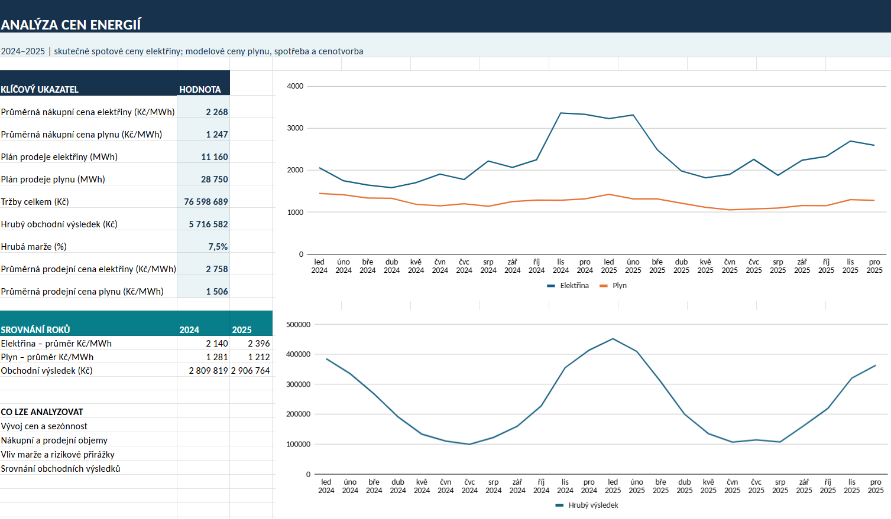

# Analýza cen elektřiny a zemního plynu v ČR (2024–2025)

Projekt představuje analytický model pro sledování vývoje velkoobchodních cen energií, plánování nákupních a prodejních objemů a simulaci obchodních cen pro koncové zákazníky.

## 1. Business problém

Dodavatel energií potřebuje sledovat změny tržních cen elektřiny a plynu a vyhodnocovat jejich možný dopad na cenotvorbu a obchodní výsledky. Cílem projektu je vytvořit přehledný nástroj, který propojí cenová data, model spotřeby a scénáře marží pro podporu rozhodování o nákupu a prodeji komodit.

## 2. Data

Analýza pokrývá **leden 2024 až prosinec 2025 (24 měsíců)**.

| Datová oblast | Rozsah | Původ a charakter |
|---|---|---|
| Elektřina | 24 měsíčních cen, Kč/MWh | Historické měsíční spotové ceny pro ČR, převzaté z portálu Spotová elektřina (data odkazují na trh OTE) |
| Zemní plyn – roční benchmark | 2 roční hodnoty, EUR/MWh | Publikované referenční ceny vnitrodenního trhu OTE / ERÚ |
| Zemní plyn – měsíční řada | 24 hodnot, Kč/MWh | **Syntetická data** pro demonstraci modelu |
| Spotřeba a plán nákupu | 24 měsíčních období | **Modelové objemy** odvozené od vstupních parametrů a sezónnosti |
| Cenotvorba a výsledky | 24 měsíčních období | **Simulace**, nikoli skutečné obchodní výsledky dodavatele |

**Zdroje:** [Historické ceny elektřiny 2024](https://spotovaelektrina.cz/historicke-ceny/2024/01), [historické ceny elektřiny 2025](https://spotovaelektrina.cz/historicke-ceny/2025/1), [ERÚ – zpráva 2024](https://eru.gov.cz/sites/default/files/obsah/prilohy/sp2024.pdf), [OTE – výsledky 2025](https://www.ote-cr.cz/cs/o-spolecnosti/zpravy_ote/tz_20260105_objemy-obchodu-v-r-2025-1.pdf). Ceny elektřiny jsou převzaté a zaokrouhlené na celé Kč/MWh; před použitím pro obchodní rozhodnutí je nutné ověřit metodiku a zdrojové hodnoty.

## 3. Analýza a hlavní zjištění

V Excelu jsem propojil tržní data s modelovanou sezónní spotřebou, plánem nákupu, obchodními přirážkami a výpočtem tržeb, nákladů a hrubého obchodního výsledku. Dashboard umožňuje porovnat oba roky a měnit vstupní předpoklady.

### Vývoj ceny elektřiny

| Ukazatel | 2024 | 2025 |
|---|---:|---:|
| Průměrná měsíční cena elektřiny | 2 140 Kč/MWh | 2 396 Kč/MWh |
| Meziroční změna průměru | — | **+12,0 %** |

Nejvyšší měsíční hodnota v souboru je **3 366 Kč/MWh (listopad 2024)** a nejnižší **1 587 Kč/MWh (duben 2024)**. Rozdíl ukazuje význam cenového rizika při plánování nákupu.

### Modelový obchodní výsledek

| KPI za 24 měsíců | Výsledek v základním scénáři |
|---|---:|
| Plánovaný prodej elektřiny | 11 160 MWh |
| Plánovaný prodej plynu | 28 750 MWh |
| Simulované tržby celkem | 76,60 mil. Kč |
| Simulovaný hrubý obchodní výsledek | 5,72 mil. Kč |
| Simulovaná hrubá marže | 7,46 % |

### Ukázka vývoje cen elektřiny

| Měsíc | Cena (Kč/MWh) |
|---|---:|
| leden 2024 | 2 063 |
| duben 2024 | 1 587 |
| listopad 2024 | 3 366 |
| leden 2025 | 3 231 |
| duben 2025 | 1 985 |
| prosinec 2025 | 2 595 |

## Dashboard: 
 .

## 4. Doporučení pro business

- **Pravidelně vyhodnocovat cenové výkyvy** a aktualizovat vstupy do cenotvorby, protože historické měsíční ceny elektřiny se výrazně liší.
- **Porovnávat scénáře marže, rizikové přirážky a rezervy nákupu** před nastavením obchodní ceny pro zákazníky.
- **Zpřesňovat plán spotřeby podle sezónnosti** a skutečných odběrových profilů; modelové objemy mohou sloužit pouze jako první orientační scénář.

## 5. Omezení a další kroky

Model je **ukázkový analytický nástroj**, nikoli kompletní metodika cenotvorby dodavatele energií. Měsíční ceny plynu a spotřeba jsou syntetické; roční referenční ceny plynu nejsou přímo propojeny s měsíčním výpočtem. Výpočet nezahrnuje všechny složky koncové ceny, například distribuci, další regulované platby a daně. Historické spotové ceny také nejsou totožné se skutečnou nákupní cenou portfolia při zajišťování komodit.

Další rozvoj: získat ověřenou měsíční řadu cen plynu, doplnit reálné odběrové profily a forwardové ceny, vytvořit citlivostní scénáře a automatizovat aktualizaci dat pomocí Power Query nebo SQL. Před produkčním využitím je potřeba validovat výpočty proti interní metodice obchodníka.

## Struktura Excel souboru

| List | Obsah |
|---|---|
| `Dashboard` | Přehled KPI a porovnání let |
| `Vstupní parametry` | Nastavení marží, nákladů a spotřeby |
| `Tržní data` | Historické ceny elektřiny a modelové měsíční ceny plynu |
| `Spotřeba a plán` | Sezónní profily, objemy nákupu a prodeje |
| `Cenotvorba` | Model prodejních cen, tržeb, nákladů a výsledku |
| `Metodika` | Vysvětlení výpočtů a zdrojů |
| `Ověřené ceny plynu` | Roční referenční ceny plynu |

## Jak projekt spustit

1. Stáhněte soubor `Analyza_cen_energii_CZ_historicka_data.xlsm` z tohoto repozitáře.
2. Otevřete jej v Microsoft Excelu.
3. Prohlédněte si `Dashboard` a `Metodika`.
4. Na listu `Vstupní parametry` změňte modelové předpoklady a sledujte přepočet cenotvorby a KPI.

**Použité nástroje:** Microsoft Excel, vzorce, grafy, modelování KPI.
